# Relay: the chat system from *System Design Interview*, Chapter 12

A working implementation of the chat system Alex Xu designs in *System Design Interview: An Insider's Guide*, Chapter 12.
It covers 1:1 chat, group chat with up to 100 members, and online presence.

The backend is a set of Spring Boot 4 / Java 25 microservices that follow the book's architecture: stateless API servers, stateful chat servers found through ZooKeeper service discovery, a Kafka message sync queue, Cassandra for history, Redis for ids, sessions and presence, and nginx as the load balancer.
The frontend is Angular 22.

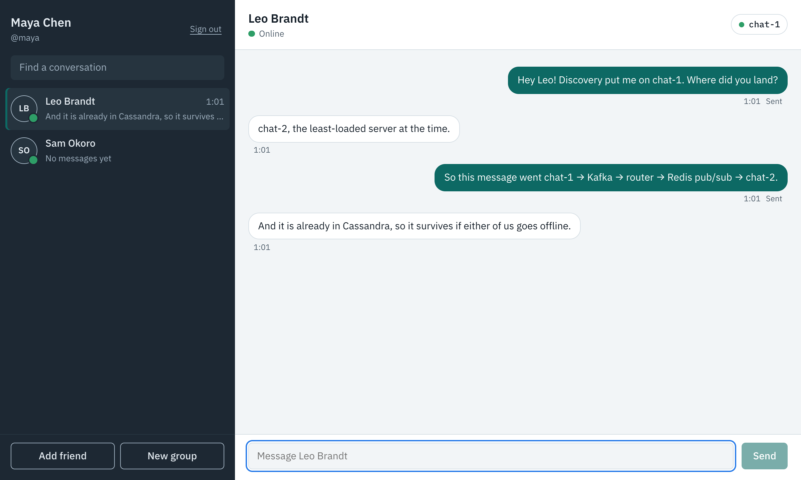

## Contents

- [Features](#features)
- [Architecture](#architecture)
- [End-to-end walkthrough](#end-to-end-walkthrough)
- [Quick start with Docker](#quick-start-with-docker)
- [Local development](#local-development)
- [Project structure](#project-structure)
- [API reference](#api-reference)
- [Configuration](#configuration)
- [Testing](#testing)
- [Security notes](#security-notes)
- [Troubleshooting](#troubleshooting)
- [Further reading](#further-reading)

## Features

| Feature | How it works |
|---|---|
| Accounts | Sign up and sign in with a username and password; the API issues a JWT (HS256) that every service verifies. |
| Friends | A friend request must be accepted before two people can message each other or see each other's presence. Requests sent in both directions count as consent. |
| 1:1 chat | Real-time delivery over WebSocket, even when the two people are connected to different chat servers. |
| Group chat | Up to 100 members. The owner can remove members, and members can leave. |
| Delivery states | Each of your messages shows *Sending*, *Sent* (acknowledged once it is in Kafka) or *Not sent* with a Retry button. Retries never create duplicates. |
| History | Stored in Cassandra and loaded 50 messages at a time as you scroll up. |
| Presence | Online / *Last seen …* for friends, from 5-second heartbeats. Closing the tab marks you offline after 30 seconds; signing out marks you offline immediately. |
| Unread counts | Badges on conversations you are not looking at. |
| Failover | If a chat server dies, the client finds another one through service discovery and sends anything still unsent. |
| Responsive, dark mode | Works on phones; follows the operating system's light or dark setting. |

## Architecture

```
                         ┌───────────────── nginx (load balancer, :8000) ─────────────────┐
 browser ──HTTP /api────▶│  api-service ×2        stateless: auth, friends, groups,         │──▶ PostgreSQL
    │                    │                        history, service discovery               │──▶ Cassandra
    │ ──WS /ws/presence─▶│  presence-service ×2   heartbeats, online/offline fan-out        │──▶ Redis
    │                    └──────────────────────────────────────────────────────────────────┘
    │
    └──WS, direct to the server discovery picked──▶ chat-service chat-1 (:8091) / chat-2 (:8092)
                                                     │  register in ──▶ ZooKeeper
                                                     │  produce to ───▶ Kafka "message.sync"
                                                     │                   ├─ persister group ──▶ Cassandra
                                                     │                   └─ router group ─────▶ Redis pub/sub ──▶ recipient's chat server
```

| Book component | This repository |
|---|---|
| Load balancer | nginx ([`infra/nginx.conf`](infra/nginx.conf)) |
| API servers (login, signup, profile, groups) | `backend/api-service` |
| Service discovery (Apache ZooKeeper) | ZooKeeper plus Apache Curator. api-service hands each client the chat server with the fewest connections. |
| Chat servers (stateful) | `backend/chat-service`, run as `chat-1` and `chat-2` |
| Presence servers | `backend/presence-service` |
| Message ID generator | A per-channel Redis counter (the book's "local sequence number generator") |
| Message sync queue | Kafka topic `message.sync`, keyed by channel so each conversation stays in order |
| Key-value store | Cassandra table `messages_by_channel` |
| Relational database | PostgreSQL: users, friend requests, friendships, groups |
| Notification servers | Out of scope; the router marks where they would plug in |

**How a message travels:**
1. Maya's browser sends it over her WebSocket to `chat-1`.
2. `chat-1` checks that she is a member of the conversation and takes the next message id from Redis.
3. It appends the message to Kafka and acknowledges it to Maya.
4. One Kafka consumer group writes the message to Cassandra.
5. A second consumer group looks up which chat server Leo is connected to (`chat-2`) and publishes to that server's Redis channel.
6. `chat-2` pushes the message down Leo's WebSocket.

[`docs/DESIGN.md`](docs/DESIGN.md) has the full design: requirements, back-of-the-envelope estimates, sequence diagrams, data model, Redis keys and every deviation from the book.

## End-to-end walkthrough

These screenshots come from a real run against the Docker stack, driven by [`e2e/screenshots.mjs`](e2e/screenshots.mjs) with three users, Maya, Leo and Sam, each in their own browser.

### 1. Sign up

Each person creates an account. Service discovery then connects each browser to the least-loaded chat server: Maya and Sam land on `chat-1`, Leo on `chat-2`. The badge in the header shows which server you are on.

<p>
  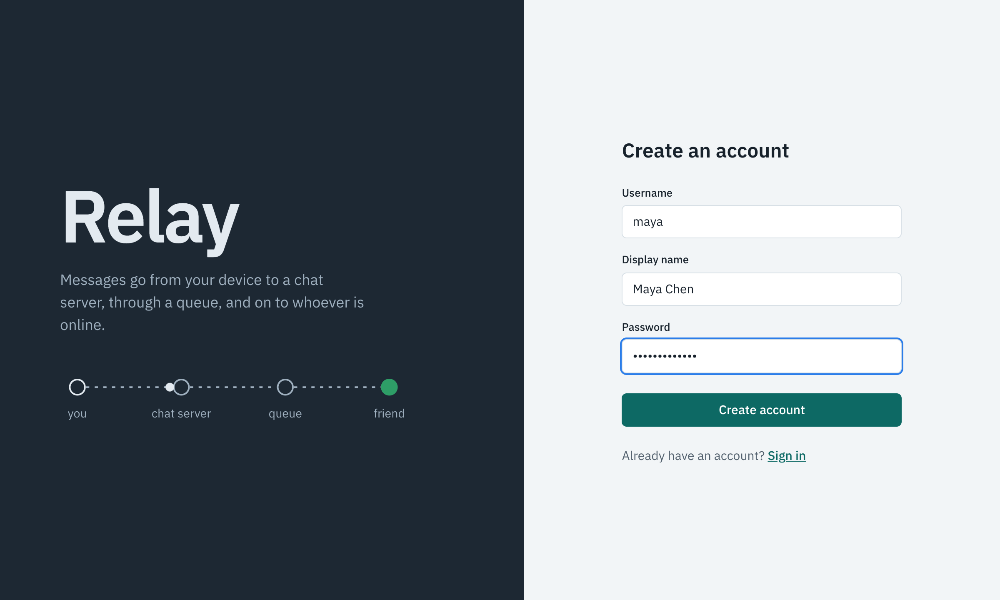
  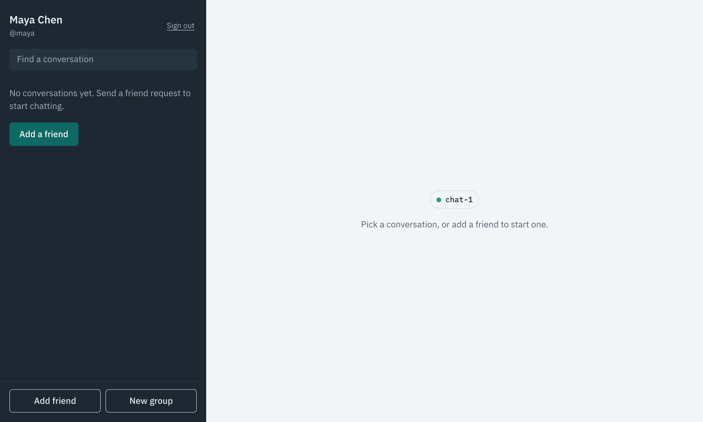
</p>

### 2. Friend requests

Maya searches for Leo and sends a request. Leo sees it appear in his sidebar without reloading the page. Until he accepts, Maya cannot message him or see when he is online.

<p>
  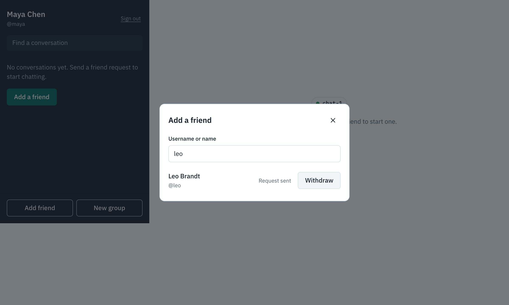
  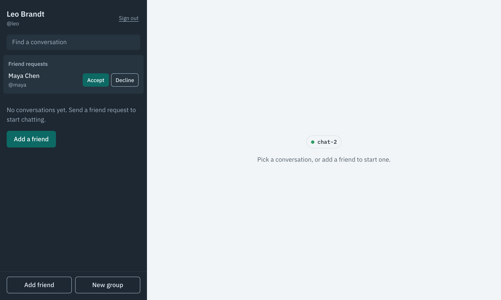
</p>

### 3. Chat across two chat servers

Maya (on `chat-1`) and Leo (on `chat-2`) chat in real time. Messages cross servers through Kafka and Redis pub/sub. Each message Maya sends shows *Sent* once the chat server has acknowledged it.

<p>
  
  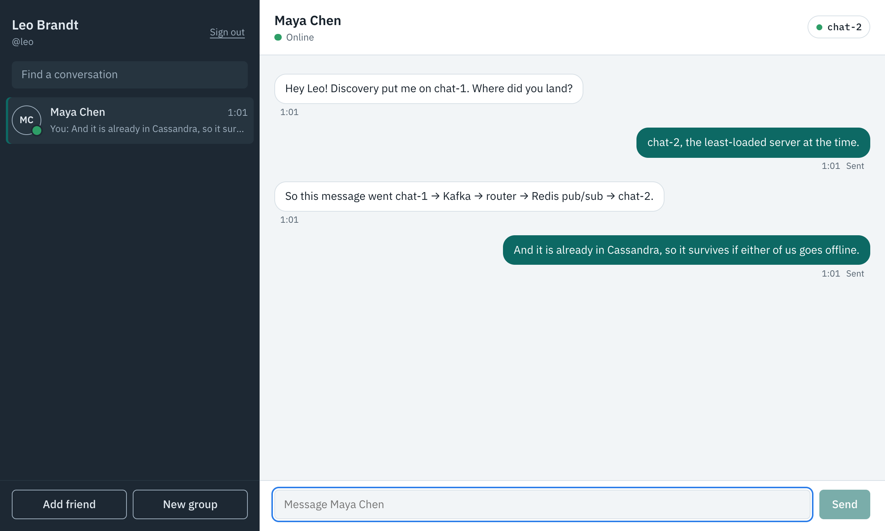
</p>

### 4. Group chat

Maya creates a group from her friends; groups can have up to 100 members. Messages in a group are labelled with the sender's name. Leo has the group closed, so it shows an unread count. Member presence for groups is looked up when the group is opened rather than pushed, as the book recommends.

<p>
  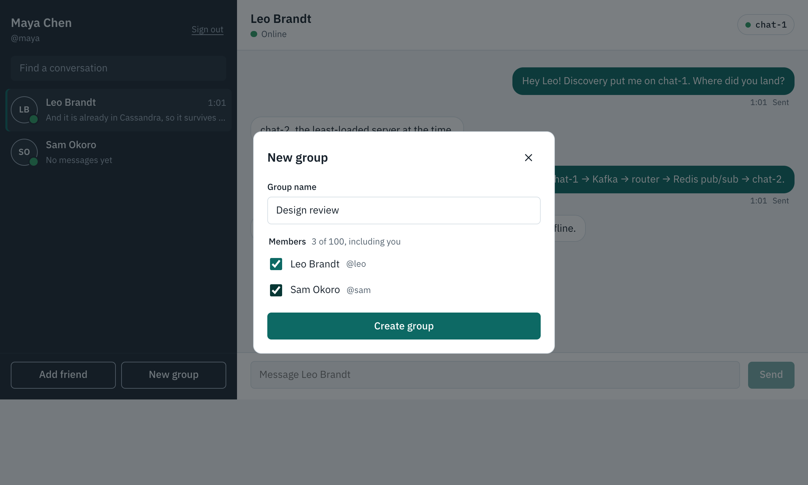
  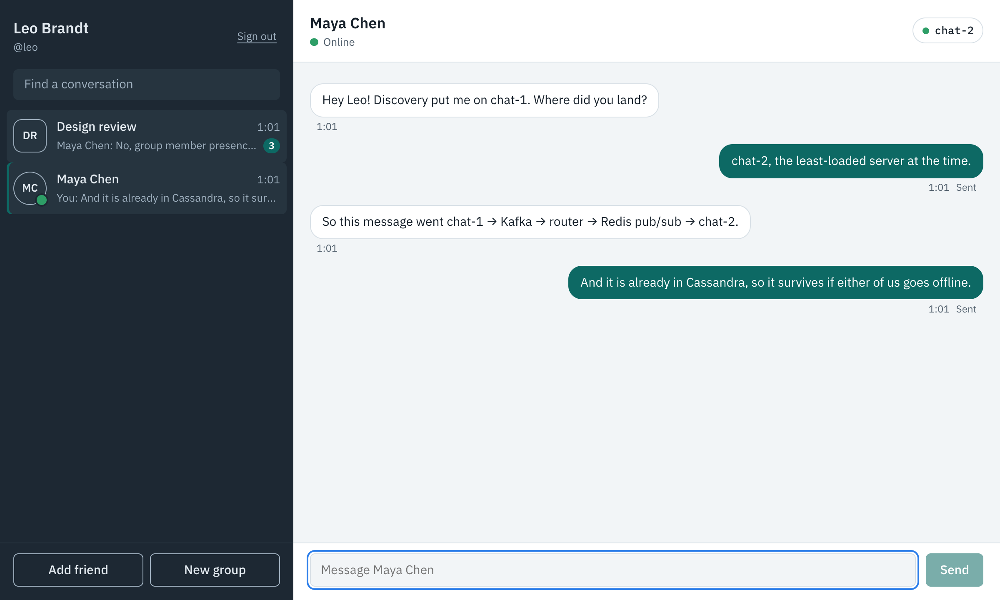
</p>

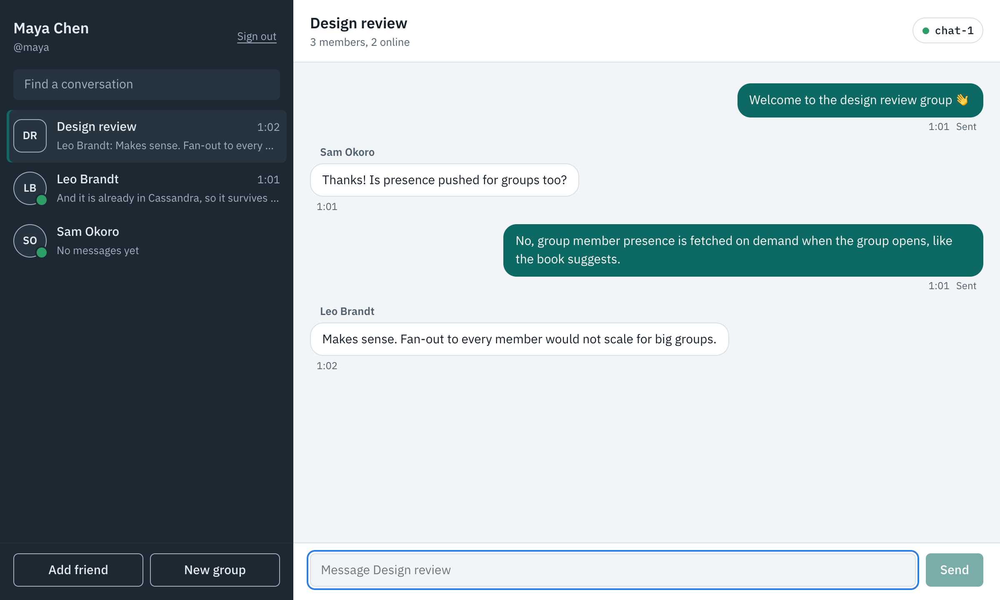

### 5. Presence

Leo closes his browser without signing out. His heartbeats stop, his presence key in Redis expires, and Maya sees *Last seen just now* (about 40 seconds later in this run). A dropped connection on its own does not make anyone look offline; this is how the book avoids flicker on flaky networks.


### 6. Chat server failover

Running `docker stop chat-1` disconnects Maya and Sam. The badge turns amber and any unsent message waits. The client then asks discovery again, which no longer lists `chat-1`, so it reconnects to `chat-2`. The next message is delivered as usual.

<p>
  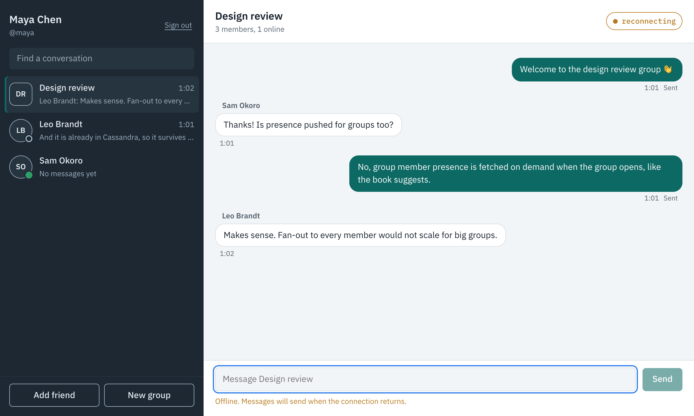
  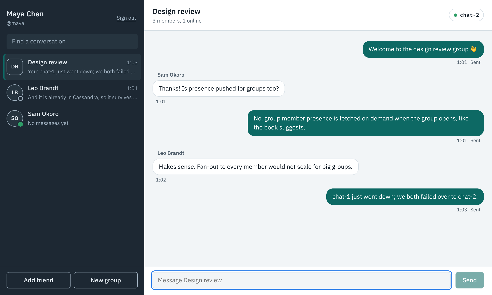
</p>

### 7. Phone layout and dark mode

On a narrow screen the conversation list and the conversation are separate screens. Colours follow the operating system's dark mode.

<p>
  
  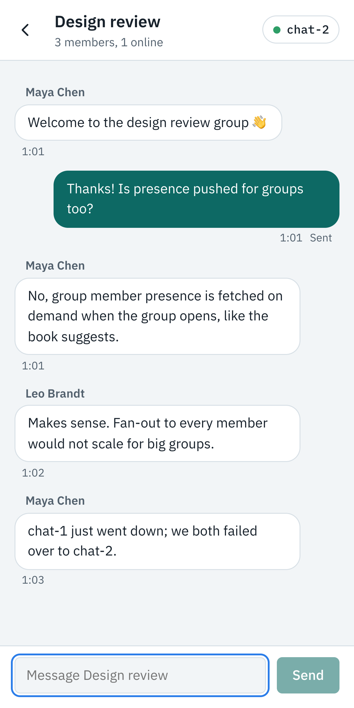
  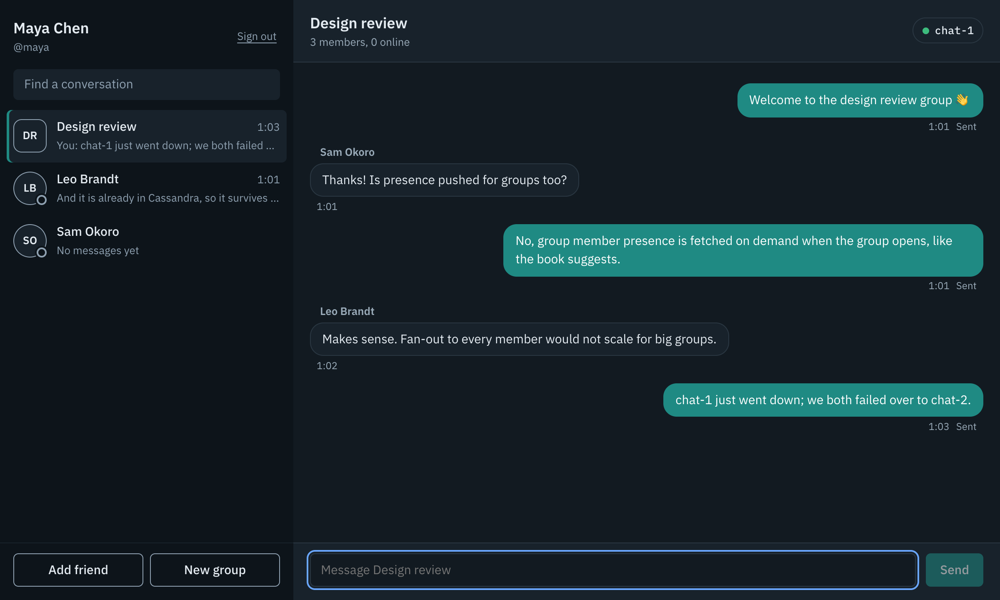
</p>

## Quick start with Docker

Requirements: Docker Desktop with **at least 4 GB of memory** (6 GB is comfortable). See [Troubleshooting](#troubleshooting) if Docker has less.

```bash
cd infra
echo "CHAT_JWT_SECRET=$(openssl rand -base64 48)" > .env   # once; .env is gitignored
docker compose --profile app up -d --build                  # first build takes several minutes
open http://localhost:8000
```

This starts PostgreSQL, Cassandra, Redis, ZooKeeper and Kafka, followed by two of each service and nginx. The services take a minute or two to start after the containers are up. Register two users in two different browsers (or one normal and one private window) and follow the walkthrough above.

| Command | What it does |
|---|---|
| `docker compose up -d` | Infrastructure only (for local development) |
| `docker compose --profile app up -d --build` | Everything, rebuilding images after code changes |
| `docker compose --profile app ps` | Status of every container |
| `docker compose --profile app logs -f chat-1` | Follow one service's logs |
| `docker stop chat-1` / `docker start chat-1` | Try failover |
| `docker compose --profile app down` | Stop everything (add `-v` to delete the data) |

## Local development

Run the infrastructure in Docker and the services on your machine (Java 25, Maven 3.9, Node 24+):

```bash
cd infra && docker compose up -d                          # PostgreSQL, Cassandra, Redis, ZooKeeper, Kafka

export CHAT_JWT_SECRET=$(openssl rand -base64 48)         # the same value for every service below
cd backend && mvn install -DskipTests
java -jar api-service/target/api-service-0.1.0-SNAPSHOT.jar                 # :8080
java -jar chat-service/target/chat-service-0.1.0-SNAPSHOT.jar               # chat-1 on :8091
SERVER_PORT=8092 CHAT_SERVER_ID=chat-2 CHAT_PUBLIC_WS_URL=ws://localhost:8092/ws/chat \
  java -jar chat-service/target/chat-service-0.1.0-SNAPSHOT.jar             # chat-2 on :8092
java -jar presence-service/target/presence-service-0.1.0-SNAPSHOT.jar       # :8070

cd frontend && npm install && npx ng serve                # http://localhost:4200
```

`ng serve` proxies `/api` to api-service and `/api/v1/presence` and `/ws/presence` to presence-service ([`frontend/proxy.conf.json`](frontend/proxy.conf.json)). The browser connects to chat servers directly at the URL that discovery returns.

Stop the Docker `app` profile first, because its chat servers also use ports 8091 and 8092.

## Project structure

```
backend/                      Maven multi-module build (Spring Boot 4.1, Java 25)
  chat-common/                Wire types, Redis key names, channel ids, JWT issue/verify, WebSocket auth
  api-service/                REST API, PostgreSQL (Flyway migrations), Cassandra reads, chat-server discovery
  chat-service/               Chat WebSocket, message ids, Kafka producer, persister and router consumers
  presence-service/           Presence WebSocket, heartbeats, key-expiry listener, presence lookup
frontend/                     Angular 22 app (standalone components, signals, Signal Forms)
  src/app/core/               API client, auth, chat and presence sockets, ChatStore state
  src/app/features/auth/      Sign-in and sign-up page
  src/app/features/chat/      Sidebar, conversation, dialogs, connection badge
infra/                        docker-compose.yml, nginx.conf, Dockerfiles, Cassandra schema, .env.example
e2e/                          Browser walkthrough that produced the screenshots
docs/                         DESIGN.md and screenshots
```

## API reference

All REST endpoints live under `/api/v1`. Every endpoint except `auth/*` needs `Authorization: Bearer <token>`. Errors are returned as RFC 9457 problem details (`{"status", "title", "detail"}`).

### REST

| Method and path | Service | Purpose |
|---|---|---|
| `POST /auth/register` | api | `{username, displayName, password}` → `{token, user}`. Usernames are 3–32 letters, digits or `_`; passwords are 6–72 characters. |
| `POST /auth/login` | api | `{username, password}` → `{token, user}` |
| `GET /users/me` | api | The signed-in user |
| `GET /users/search?q=` | api | Up to 20 users whose username or display name starts with `q` |
| `GET /friends` | api | Accepted friends |
| `GET /friends/requests` | api | `{incoming: [...], outgoing: [...]}` pending requests |
| `POST /friends/requests/{userId}` | api | Send a request → `{status: PENDING \| ACCEPTED, user}` (ACCEPTED if they had already asked you) |
| `POST /friends/requests/{userId}/accept` | api | Accept their request |
| `DELETE /friends/requests/{userId}` | api | Decline an incoming request or withdraw an outgoing one |
| `GET /groups`, `GET /groups/{id}` | api | Your groups (or one group), with members |
| `POST /groups` | api | `{name, memberIds}`. You are added as owner; at most 100 members. |
| `POST /groups/{id}/members` | api | `{userIds}`: add members (members only) |
| `DELETE /groups/{id}/members/{userId}` | api | The owner removes someone, or a member leaves |
| `GET /channels` | api | Your conversations (DMs and groups) with members and last message, most recent first |
| `GET /channels/{channelId}/messages?before=&limit=` | api | History in chronological order. `before` is a message id; `limit` is at most 100 (default 50). |
| `GET /chat/server` | api | Service discovery: `{serverId, wsUrl, connections}` for the least-loaded chat server |
| `GET /chat/servers` | api | Every registered chat server and its connection count |
| `GET /presence?userIds=1,2` | presence | Online status and last-active time for up to 100 users |
| `POST /presence/offline` | presence | Mark yourself offline now (sent on sign-out) |

Channel ids are `dm:{smallerUserId}:{largerUserId}` for a 1:1 conversation and `g:{groupId}` for a group.

### Chat WebSocket: `ws://<server from discovery>/ws/chat?token=<jwt>`

| Direction | Frame | Meaning |
|---|---|---|
| server → client | `{"type":"CONNECTED","serverId","userId"}` | Connected to this chat server |
| client → server | `{"type":"SEND","clientMsgId","channelId","content"}` | Send a message. `clientMsgId` is a unique id from the client; resending it is safe. Content can be up to 4,000 characters. |
| server → client | `{"type":"ACK","clientMsgId","message"}` | Accepted into the sync queue; `message` has its `messageId` and `createdAt` |
| server → client | `{"type":"MESSAGE","message"}` | A new message in one of your conversations |
| server → client | `{"type":"ERROR","clientMsgId","error"}` | The send was rejected, for example *You are not a member of this channel* |
| client ↔ server | `{"type":"PING"}` → `{"type":"PONG"}` | Keep-alive (the client pings every 25 seconds) |

`message` is `{channelId, messageId, senderId, content, createdAt}`, where `createdAt` is in epoch milliseconds and `messageId` increases within each conversation.
A newer connection for the same account closes the older one with code `4001`.

### Presence WebSocket: `ws://<host>/ws/presence?token=<jwt>` (through nginx)

| Direction | Frame | Meaning |
|---|---|---|
| client → server | `{"type":"HEARTBEAT"}` | Every 5 seconds. Missing them for 30 seconds marks you offline. |
| server → client | `{"type":"SNAPSHOT","presences":[...]}` | Your friends' status. Sent on connect and again whenever a friend request involving you is sent, accepted or withdrawn. |
| server → client | `{"type":"PRESENCE","presence":{userId, online, lastActiveAt}}` | A friend came online or went offline |

## Configuration

Spring Boot reads each setting from an environment variable or from the service's `application.yml`.

| Variable | Services | Default | Notes |
|---|---|---|---|
| `CHAT_JWT_SECRET` | all | **none (required)** | At least 32 bytes and identical for every service. Services refuse to start without it. |
| `CHAT_JWT_TTL` | api | `24h` | Token lifetime |
| `CHAT_MAX_GROUP_SIZE` | api | `100` | Includes the owner |
| `CHAT_ZOOKEEPER_CONNECT` | api, chat | `localhost:2181` | |
| `CHAT_SERVER_ID` | chat | `chat-1` | Unique per chat server; also its ZooKeeper instance id |
| `CHAT_PUBLIC_WS_URL` | chat | `ws://localhost:8091/ws/chat` | The address browsers use to reach this server, as published through discovery |
| `CHAT_MAX_MESSAGE_LENGTH` | chat | `4000` | |
| `CHAT_PRESENCE_TTL` | presence | `30s` | How long after the last heartbeat a user turns offline |
| `SPRING_DATASOURCE_URL` | api | `jdbc:postgresql://localhost:5432/chat` | Username and password `chat` / `chat` |
| `SPRING_DATA_REDIS_HOST` | all | `localhost` | Redis needs `notify-keyspace-events Ex`; presence-service tries to set it on startup |
| `SPRING_CASSANDRA_CONTACT_POINTS` | api, chat | `127.0.0.1:9042` | Keyspace `chat` (created by [`infra/cassandra-init.cql`](infra/cassandra-init.cql)) |
| `SPRING_KAFKA_BOOTSTRAP_SERVERS` | chat | `127.0.0.1:9092` | |

## Testing

```bash
cd backend && mvn verify                  # unit + integration tests; needs Docker for Testcontainers
cd frontend && npx ng test --watch=false  # Vitest
```

The backend has 34 tests. The integration tests start real PostgreSQL, Cassandra, Kafka and Redis containers with Testcontainers, plus an embedded ZooKeeper.

| Module | What is covered |
|---|---|
| chat-common | Channel id parsing; JWT issue/verify, expiry, wrong key, missing or published secret |
| api-service | Friend requests grant nothing until accepted; only the recipient can accept; requests in both directions become a friendship; declining; Redis membership mirroring; message counters start at 0 for new conversations and are never reset for existing ones; group size cap; history access; least-loaded discovery; 401 without a token |
| chat-service | WebSocket send → ACK → delivered to the other user → stored in Cassandra; resends are idempotent; non-members are rejected; the handshake needs a valid token; router fan-out to online users only; message id seeding |
| presence-service | First heartbeat → ONLINE; missed heartbeats → key expiry → OFFLINE; sign-out is immediate; the watcher index keeps up with friend changes |

The frontend has 10 Vitest tests covering the conversation store:
- the send/ACK/failed/retry outbox
- ordering and duplicate handling
- unread counts
- accepting a friend request
- refreshing on every presence snapshot
- ignoring stale overlapping refreshes
- on-demand group presence

### End-to-end screenshots

[`e2e/screenshots.mjs`](e2e/screenshots.mjs) drives a local Chrome through the whole walkthrough against the running Docker stack and saves every image in `docs/screenshots/`. It stops and restarts `chat-1` for the failover step.

```bash
cd e2e && npm install
node screenshots.mjs ../docs/screenshots                                   # set CHROME_PATH if Chrome is not in /Applications
docker exec -i chat-system-postgres-1 psql -U chat < reset-demo-users.sql  # before running it again
```

## Security notes

- **No committed secrets.** The JWT signing key comes only from `CHAT_JWT_SECRET`. Services refuse to start without one, and refuse the example value from this repository's early history.
- **Consent.** Messaging and presence need an accepted friend request, so a stranger can't message you or watch when you are online. Chat servers check channel membership on every send, and the API checks it on every history read.
- **WebSocket auth.** Browsers can't set headers on a WebSocket, so the token is passed as `?token=` and verified during the handshake. Serve the app over HTTPS/WSS outside local use, so the token can't be read in transit.
- **Not production-hardened.** There is no TLS, no rate limiting, no refresh tokens or revocation, and no account recovery. The default database passwords are for local use only.

## Troubleshooting

| Symptom | Cause and fix |
|---|---|
| A service keeps restarting with *CHAT_JWT_SECRET is not set* | Create `infra/.env` as shown in [Quick start](#quick-start-with-docker). |
| Cassandra restarts repeatedly, the conversation list fails, or responses take seconds | Docker is out of memory and its kernel is killing Cassandra. Check with `docker inspect chat-system-cassandra-1 --format '{{.RestartCount}}'`. Give Docker Desktop more memory, turn off its built-in Kubernetes if you don't use it, or run one replica of the stateless services: `docker compose --profile app stop api-2 presence-2` (nginx sends traffic to the remaining one). |
| The first sign-in or first message after a start takes several seconds | The services are still warming up: password hashing, the JIT compiler and first connections. Later requests take milliseconds. |
| The badge says *open elsewhere* | The same account connected from another tab. Each account has one active chat connection, and the newest wins. Reload the tab you want to use. |
| Ports 5432, 6379, 9092, 2181, 9042, 8000, 8091 or 8092 are in use | Stop whatever is using them, or change the host ports in `infra/docker-compose.yml`. |
| Changes don't appear after editing code | Rebuild: `docker compose --profile app up -d --build`. |

## Further reading

- [`docs/DESIGN.md`](docs/DESIGN.md): requirements, estimates, diagrams, data model, deviations from the book and future work, including multi-device sync, push notifications and Cassandra time buckets.
- Alex Xu, *System Design Interview: An Insider's Guide*, Chapter 12, "Design a Chat System".
