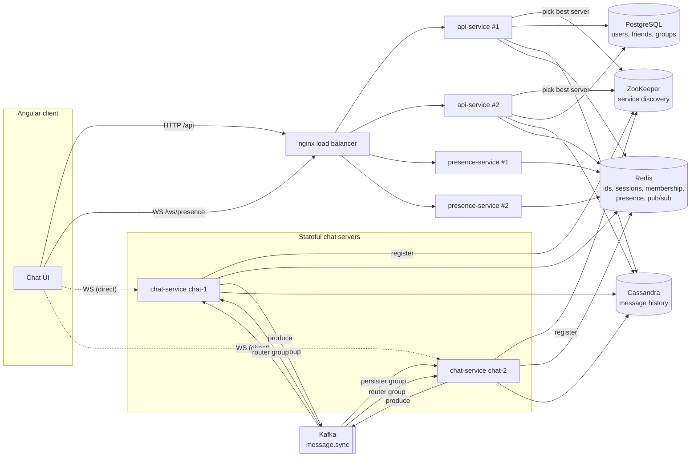
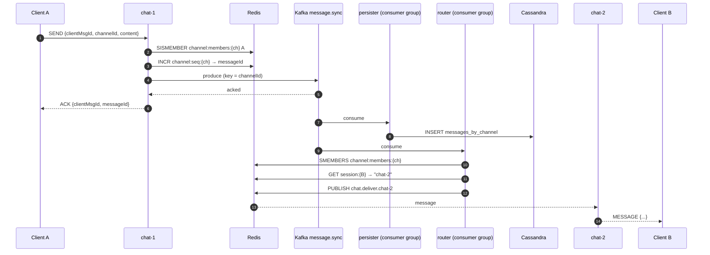
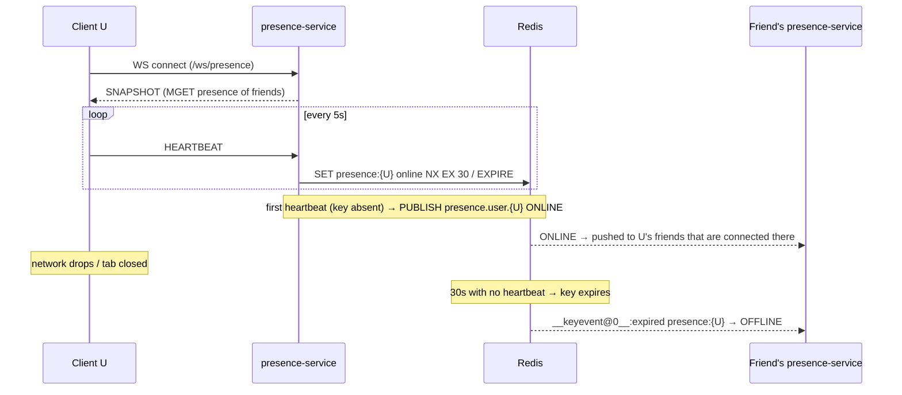

# Chat System Design

This design follows *System Design Interview: An Insider's Guide*, Chapter 12 ("Design a Chat System") by Alex Xu.
It describes what this repository actually builds. Where the code deviates from the book, the deviation is listed under **Deviations**.

---

## 1. Requirements

### Functional (in scope)
| Requirement | Notes |
|---|---|
| 1:1 chat | Low delivery latency, real time over WebSocket |
| Group chat | Up to **100** members per group |
| Online presence | Shows whether friends are online, and when they were last active |
| Message history | Stored permanently and paged by scrolling back |
| Text messages | Up to 4,000 characters (the book allows 100,000; we use a smaller limit for the UI) |

### Explicitly out of scope (hook points exist)
- Multi-device sync (`cur_max_message_id` per device)
- Push notifications for offline users. The router logs at the point where a notification would be sent.
- Attachments and media, end-to-end encryption, read receipts

### Non-functional
- Low latency for online-to-online delivery
- Per-channel ordering: messages inside a channel are totally ordered
- Horizontal scalability for every stateless tier. Chat servers are stateful, but they can be added freely through service discovery.
- Fault tolerance: if a chat server dies, its clients reconnect to another server.

---

## 2. Back-of-the-envelope estimation (the book's numbers)

| Metric | Value |
|---|---|
| DAU | 50 million |
| Messages per user per day | 40 |
| Messages per day | 2 billion, about **23K writes/s** on average and about 50K/s at peak |
| Average message size | about 100 bytes, giving about 200 GB/day and **about 73 TB/year** of raw history |
| Concurrent connections | about 10% of DAU, so 5M. At about 10KB per connection, that is about 50GB of RAM across the chat fleet. |
| Presence heartbeats | 5M connections ÷ 5s, about **1M heartbeats/s**. Each one is a Redis `SET … EX`, so Redis must be sharded at this scale. |

These numbers are why history lives in a wide-column key-value store (Cassandra) and not in the relational database. The read/write ratio for 1:1 chat is about 1:1, the data grows quickly, and access is mostly to recent data.

---

## 3. High-level design



### How the book's components map to services
| Book component | This repository |
|---|---|
| Load balancer | `nginx` (`infra/nginx.conf`) |
| Stateless API servers: login, signup, profile, groups | `api-service` ×2 |
| Service discovery (Apache ZooKeeper) | ZooKeeper plus Apache Curator `curator-x-discovery` |
| Stateful chat servers | `chat-service` ×2 (`chat-1`, `chat-2`) |
| Presence servers | `presence-service` ×2 |
| Message ID generator | Per-channel local sequence (Redis `INCR`) |
| Message sync queue | Kafka topic `message.sync` |
| Key-value store | Cassandra |
| Relational DB for generic data | PostgreSQL |
| Notification servers | *Out of scope.* The hook point is in `MessageRouter`. |

### Service discovery
1. The client logs in through the API and receives a JWT.
2. The client calls `GET /api/v1/chat/server`. api-service lists the healthy `chat-server` instances in ZooKeeper. Each one is an **ephemeral** node, so a crashed server disappears automatically. api-service returns the instance with the fewest live connections; each chat server reports its count to Redis every few seconds.
3. The client opens a WebSocket **directly** to that chat server. The load balancer is not involved.

---

## 4. Data model

### Relational (PostgreSQL): users, friends, groups
```sql
users(id BIGSERIAL PK, username UNIQUE, display_name, password_hash, created_at)
friendships(user_id, friend_id, created_at, PK(user_id, friend_id))   -- stored in both directions
chat_groups(id BIGSERIAL PK, name, owner_id, created_at)
group_members(group_id, user_id, joined_at, PK(group_id, user_id))   -- ≤ 100 rows per group
```

### Key-value (Cassandra): messages
```sql
CREATE TABLE chat.messages_by_channel (
  channel_id text,
  message_id bigint,
  sender_id  bigint,
  content    text,
  created_at timestamp,
  PRIMARY KEY ((channel_id), message_id)
) WITH CLUSTERING ORDER BY (message_id DESC);
```
- **Channel IDs:** `dm:{minUserId}:{maxUserId}` for a 1:1 conversation and `g:{groupId}` for a group.
- **Partition key** = channel, so one conversation's history lives on one partition and is already sorted newest first. "Load older" is a single range query: `WHERE channel_id = ? AND message_id < ? LIMIT 50`.

### Message ID
The book requires message IDs to be **unique** and **sortable by time**, and offers three options: auto-increment, a global Snowflake ID, or a *local* sequence generator. We use the local one, because ordering only matters inside a channel:

```
message_id = INCR channel:seq:{channelId}      (Redis, AOF-persisted)
```
If the counter is ever lost, the chat server reseeds it from `max(message_id)` in Cassandra the first time that channel is written to again.

### Redis keys
| Key | Type | Writer → Reader | Purpose |
|---|---|---|---|
| `channel:members:{channelId}` | set | api → chat, api | Authorize sends, fan out to members |
| `friends:{userId}` | set | api → presence | Who should see my presence |
| `session:{userId}` | string (TTL 60s, refreshed) | chat → chat | Which chat server holds the user's socket |
| `chat:server:conns:{serverId}` | string (TTL 30s) | chat → api | Least-connections discovery |
| `channel:seq:{channelId}` | counter | chat | Message ID generator |
| `presence:{userId}` | string (TTL 30s) | presence | The user is online while the key exists |
| `presence:last_active:{userId}` | string | presence | Last heartbeat time (epoch ms) |

api-service rebuilds the two membership sets from PostgreSQL at startup, so Redis can be flushed safely.

---

## 5. Message flows

### 1:1 and group send


- **Ordering:** the Kafka key is `channelId`, so every message in a channel goes to one partition and is consumed in order.
- **Persisting and routing are separate consumer groups.** A slow Cassandra write never delays live delivery, and each concern scales on its own.
- **Group chat** is the same flow. The router simply fans out to up to 99 recipients. The book's "copy into each recipient's inbox" design is affordable because groups are small; here the router only fans out *delivery*, while storage stays one row per message.
- **Offline recipient:** `session:{uid}` is missing. The message is already persisted, so the user gets it from history on the next login. This is also where a push notification would be sent.

### History and reconnect
- `GET /api/v1/channels/{id}/messages?before={messageId}&limit=50` reads Cassandra.
- If the chat socket drops, the client retries with exponential backoff and **runs discovery again**, so a dead server is skipped. After reconnecting, it re-fetches the open channel's latest page and merges by `messageId`.

---

## 6. Online presence



- **Heartbeat, not disconnect:** a WebSocket close does **not** mark the user offline. Only a missing heartbeat does, after 30s. This is the book's fix for flapping caused by flaky mobile networks. An explicit logout marks the user offline immediately.
- **Fan-out:** the book describes a pub/sub channel per friend pair. Here each presence instance subscribes **once** to the patterns `presence.user.*` and `__keyevent@0__:expired`, and keeps a local *watcher index* (`watchedUserId → local sessions`). The behaviour is the same, but an instance holds 2 Redis subscriptions instead of thousands.
- **Groups:** the book says presence fan-out is too expensive for large groups and should be fetched on demand. The UI calls `GET /api/v1/presence?userIds=…` when a group is opened.

---

## 7. Deviations from the book

| Book | Here | Why |
|---|---|---|
| Separate 1:1 and group message tables | One `messages_by_channel` table | A single channel abstraction gives one ID generator, one history query and one routing path |
| Per-recipient message inbox | Router fans out delivery; storage is one row per message | The same result for ≤100-member groups, with less write amplification |
| Pub/sub channel per friend pair | Pattern subscription plus a local watcher index | The same semantics with far fewer subscriptions |
| Notification servers | Hook point only | Out of scope |
| Multi-device (`cur_max_message_id`) | A single active session per user (the newest connection wins) | Out of scope |

## 8. Future work
- **Multi-device sync:** store `cur_max_message_id` per (user, device, channel), and on connect pull everything after it.
- **Push notifications:** a notification-service consuming `offline.messages` from the router, using APNs, FCM or Web Push.
- **Cassandra hot partitions:** bucket by time, with `PRIMARY KEY ((channel_id, bucket), message_id)`, for very chatty channels.
- **Redis at the scale estimated above:** Redis Cluster, with presence and sequence keys sharded by user or channel.
- **End-to-end encryption**, read receipts, typing indicators and media through object storage plus a CDN.
